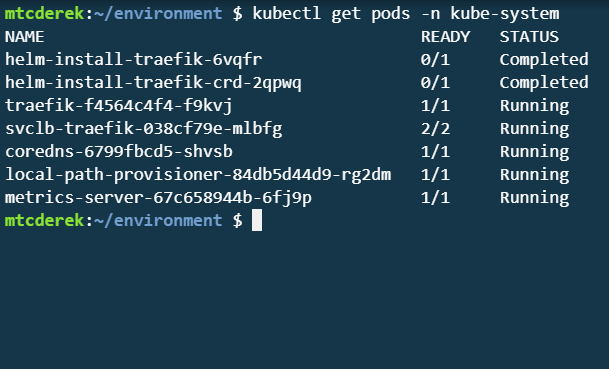
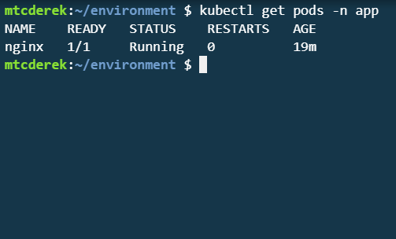
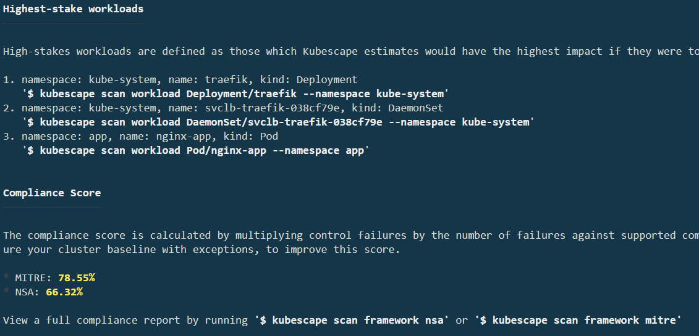
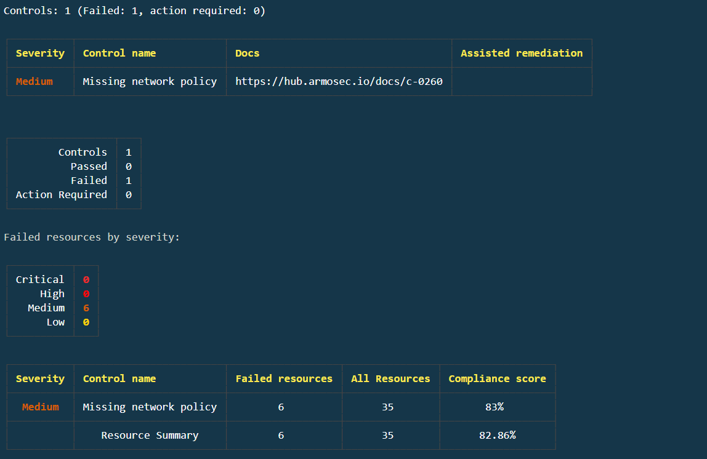
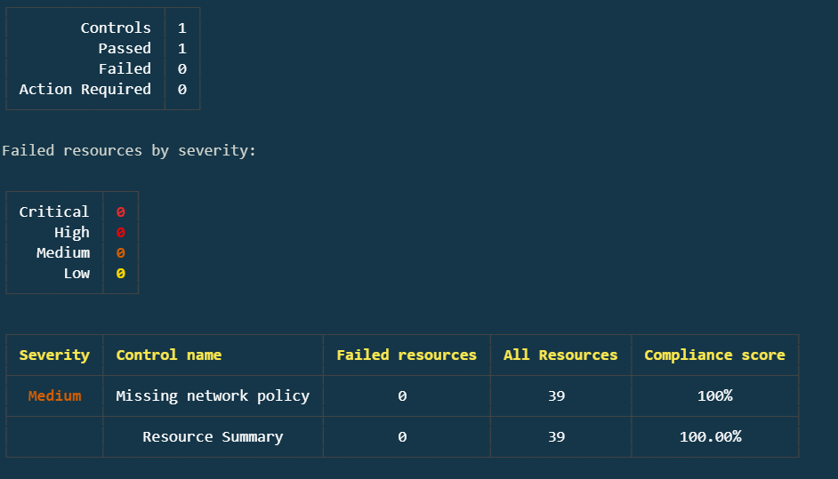
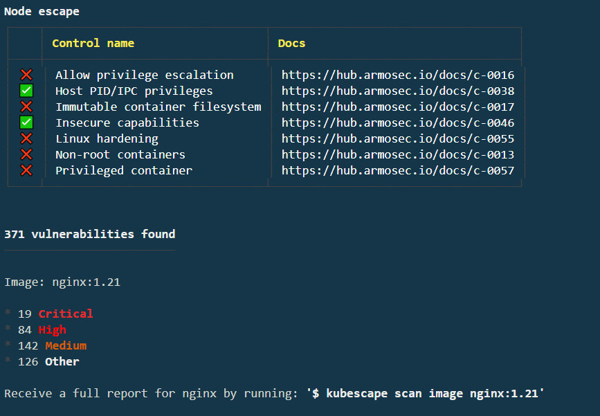
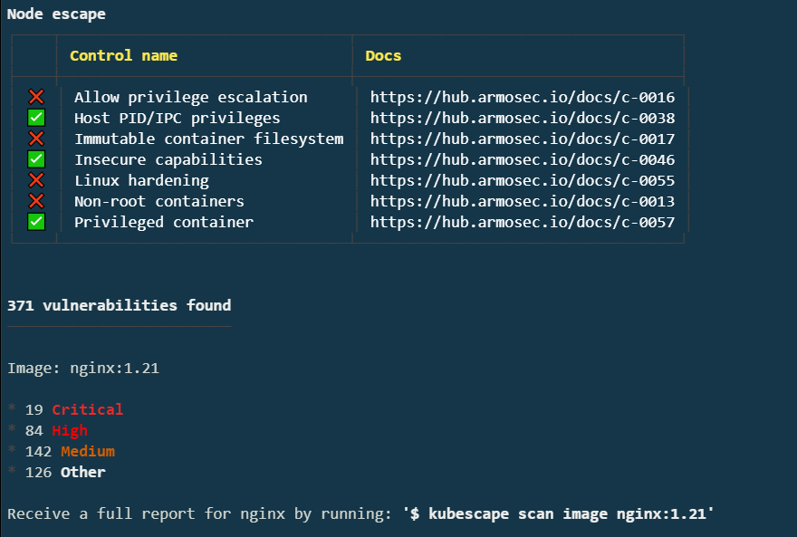
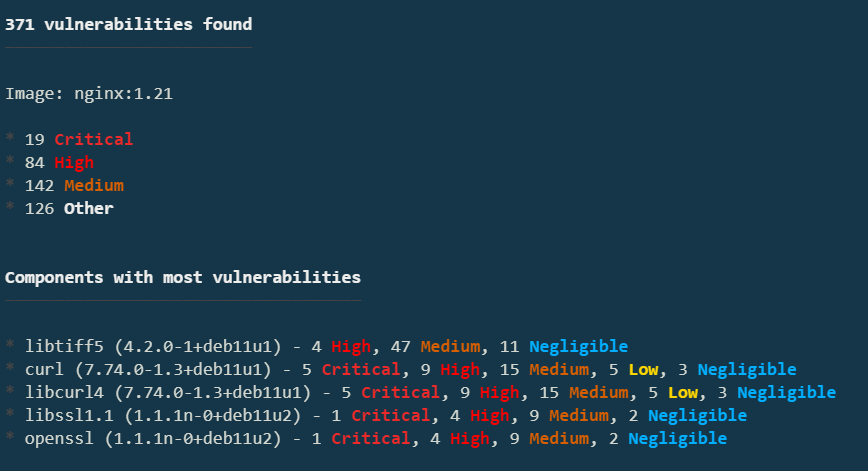
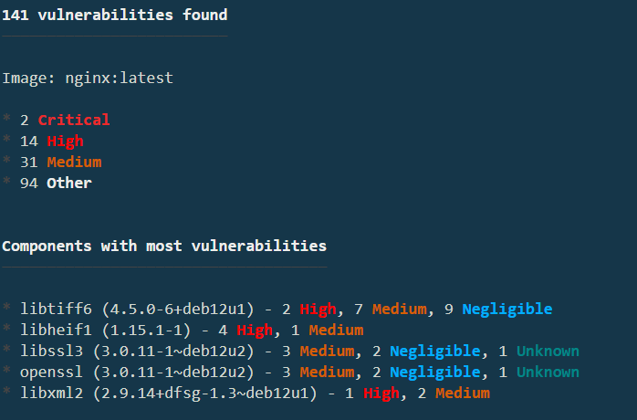

# Hardening Kubernetes workloads with the Kubescape command-line tool

## Intro

Using tools such as Kubescape to help remediate security issues in your cluster is crucial to any security plan. With Kubescape, you can scan your manifests, Helm charts, or active clusters for compliance with [security frameworks](../../frameworks-and-controls/index.md) such as NSA, MITRE, SOC 2, and more.
There are several ways to run Kubescape, including a command-line tool, an in-cluster Operator, a Visual Studio Code integration, and a GitHub action. In this guide, you will use the Kubescape command-line tool (CLI) to illustrate hardening a running Kubernetes cluster with a simple deployment. Since the Kubescape CLI is agentless, it doesn't have as much insight into the cluster as the operator does. However, it’s still a potent tool.

## Deploy a Cluster
In this example, you will use a Kubernetes cluster deployed with K3s. Any cluster will do as long as it supports a local container image registry and basic Kubectl commands. If you don’t have a cluster meeting those criteria, you can set one up using the following instructions.

### Install K3s

First, install K3s. Use the `--write-kubeconfig-mode 644` flag to allow Kubescape and non-root users to access the Kubeconfig file without `sudo`. By default, the Kubeconfig file is owned by root with privileges of `600`. The complete list of K3s configuration options can be found [here](https://docs.k3s.io/cli/server).
```shell
curl -sfL https://get.k3s.io | sh -s - --write-kubeconfig-mode 644
```

Now, configure the KUBECONFIG environment variable to point to the default location of the K3s configuration:
```shell
export KUBECONFIG=/etc/rancher/k3s/k3s.yaml
```

Verify the cluster is up:



## Deploy a Pod
For this deployment, we will use a very simple NGINX container. 

### Create the Manifest

```shell
touch nginx-app.yml
```

#### nginx-app.yml

```yaml
---
apiVersion: v1
kind: Namespace
metadata:
  name: app
  labels:
    name: app
---
apiVersion: v1
kind: Pod
metadata:
  name: nginx-app
  namespace: app
spec:
  containers:
  - name: nginx
    image: nginx:1.21
    ports:
    - containerPort: 80
    imagePullPolicy: Always
    securityContext:
        privileged: true
```

### Deploy the Pod
#### Deploy
```shell
kubectl apply -f nginx-app.yml
```
#### Verify
```shell
kubectl get pods -n app
```


Great! Now that your cluster is set up and your pod is deployed, use Kubescape to harden it.

## Use the Kubescape CLI to Detect Cluster Security Issues

### Kubescape Scan
First, install Kubescape. Do so by running the script below:
```shell
curl -s https://raw.githubusercontent.com/kubescape/kubescape/master/install.sh | /bin/bash
```

Scan the cluster against the NSA-CISA and MITRE ATT&CK frameworks.

```shell
kubescape scan framework nsa,mitre
```

Review the control results and record the compliance score for each framework. The screenshots in this guide show output from an earlier CLI version.



### Remediate a Network Control Failure

Scan for the Missing network policy control (`C-0260`). Verbose output shows which resources fail the control and how to remediate them.

```shell
kubescape scan control C-0260 -v
```



As you can see, if your terminal allows, there is a clickable link to the documentation that provides more information. In this case, it’s located at [https://kubescape.io/docs/controls/c-0260/](https://kubescape.io/docs/controls/c-0260/). Based on the information found in the ARMO documentation and the [K3s Hardening Guide](https://docs.k3s.io/security/hardening-guide#networkpolicies), create this network policy which will isolate network traffic within the cluster to its respective namespace:

#### netpol.yml

```yaml
---
kind: NetworkPolicy
apiVersion: networking.k8s.io/v1
metadata:
  name: intra-namespace
  namespace: kube-system
spec:
  podSelector: {}
  ingress:
    - from:
      - namespaceSelector:
          matchLabels:
            name: kube-system
---
kind: NetworkPolicy
apiVersion: networking.k8s.io/v1
metadata:
  name: intra-namespace
  namespace: default
spec:
  podSelector: {}
  ingress:
    - from:
      - namespaceSelector:
          matchLabels:
            name: default
---
kind: NetworkPolicy
apiVersion: networking.k8s.io/v1
metadata:
  name: intra-namespace
  namespace: kube-public
spec:
  podSelector: {}
  ingress:
    - from:
      - namespaceSelector:
          matchLabels:
            name: kube-public
---
kind: NetworkPolicy
apiVersion: networking.k8s.io/v1
metadata:
  name: intra-namespace
  namespace: app
spec:
  podSelector: {}
  ingress:
    - from:
      - namespaceSelector:
          matchLabels:
            name: app
```
Apply that policy:

```shell
kubectl apply -f netpol.yml
```

And run another scan for that control:
```shell
kubescape scan control C-0260 -v
```


Perfect! You have now remediated the C-0260 control failures. 

### Workload Scanning

Scan the `nginx-app` pod to review its control results.

```shell
kubescape scan workload Pod/nginx-app --namespace app
```


You can remediate several issues. Remediate the "Privileged container" first. If you access the [C-0057 docs](https://kubescape.io/docs/controls/c-0057/), you’ll see a nice remediation example. In the `nginx-app.yml`, you can see that our `privileged` attribute is set to `true`. Sure, this is a relatively contrived and simple example, but it’s a pretty easy fix. In your `nginx-app.yml`, change the `privileged` attribute to `false`:

```yaml
---
apiVersion: v1
kind: Namespace
metadata:
  name: app
  labels:
    name: app
---
apiVersion: v1
kind: Pod
metadata:
  name: nginx-app
  namespace: app
spec:
  containers:
  - name: nginx-app
    image: nginx:1.21
    ports:
    - containerPort: 80
    imagePullPolicy: Always
    securityContext:
        privileged: false
```
Since it's just a simple pod, delete and re-apply it:

```shell
kubectl delete -f nginx-app.yml && kubectl apply -f nginx-app.yml
```

Rerun the scan and you'll see that the `C-0057` control is remediated as indicated by the green check:

```shell
kubescape scan workload Pod/nginx-app --namespace app
```



Rerun the framework scan and compare the compliance scores with your first scan.

```shell
kubescape scan framework nsa,mitre
```

### Image Scanning
Scan the image used by the `nginx-app` pod for vulnerabilities.

```shell
kubescape scan image nginx:1.21
```


Set `image: nginx:latest` in `nginx-app.yml`, then re-create the pod.

```shell
kubectl delete -f nginx-app.yml && kubectl apply -f nginx-app.yml
```

Scan the updated image and compare the results with the first image scan.

```shell
kubescape scan image nginx:latest
```



Several vulnerabilities have been remediated! Unfortunately, not all of them, but that's the nature of security, and why you need a tool such as Kubescape. Your individual results will vary due to the current version and number of open vulnerabilities in NGINX when you’re going through this guide.

### Image Patching
To remediate the remaining vulnerabilities, you can also try to patch the image. Kubescape integrates with [Copacetic](https://github.com/project-copacetic/copacetic) to patch container images. To do so, run the following command:
```shell
kubescape patch -i nginx:latest
```
This command will create a patched image, by updating the packages to their applicable fixed-in versions. The patched image will be tagged with the suffix `-patched`. You can then deploy the patched image to your cluster.
```shell
docker images
REPOSITORY              TAG               IMAGE ID       CREATED         SIZE
nginx                   latest            fffffc90d343   3 weeks ago     188MB
nginx                   latest-patched    c9b68957ce42   3 weeks ago     190MB
```

By default, `kubescape patch` loads the patched image into your local Docker image store and does not push it to the source registry. The patched tarball is streamed from BuildKit into `docker load`, so the `docker` CLI must be available on your `PATH`.

To push the patched image to the source registry, pass the `--push` flag:

```shell
kubescape patch -i myregistry.example.com/team/app:1.2.3 --push
```

For private registries, run `docker login <registry>` before running the command. The BuildKit pull and push path reads registry credentials from your Docker credential store. The `--username` and `--password` flags authenticate the scan and re-scan steps, not the patch export.

With `--push`, BuildKit uploads the patched image to the registry and does not add it to your local Docker image store.


## Conclusion

In this guide, you have used Kubescape to scan a basic Kubernetes cluster for vulnerabilities, researched those vulnerabilities, and remediated them with a very straightforward process. Kubescape can also scan Helm manifests, Kustomize directories, and more. While this guide only scratches the surface, you can leverage Kubescape's CLI to harden your clusters to meet your own security requirements.
