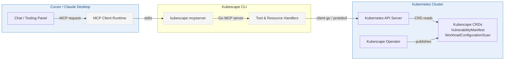
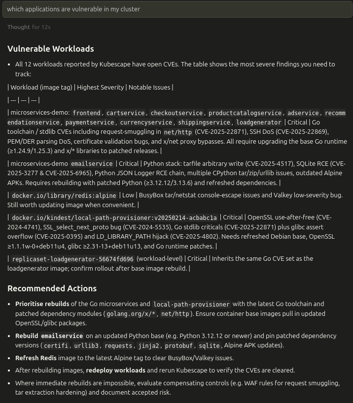

# Kubescape CLI as an MCP Server in Cursor

Kubescape exposes its Kubernetes security findings through an MCP (Model Context Protocol) server bundled inside the CLI. When you register this server in Cursor or Claude Desktop, the IDE can query live vulnerability and configuration data directly from your connected clusters.

### High Level Diagram




## Prerequisites
- `kubescape` CLI (a release that includes the `mcpserver` command, `beyond `v3.0.44`).
- Cursor version or Claude Desktop with MCP support enabled
- For the tools that read stored scan results: a reachable cluster with the Kubescape operator deployed and writing `VulnerabilityManifest`, `WorkloadConfigurationScan` and `ContainerProfile` resources. The live scan tools only need cluster access, and the local tools need no cluster (see [Available MCP Tools](#available-mcp-tools)).
- Local credentials for the cluster (`KUBECONFIG` or in-cluster context) allowing read access to Kubescape CRDs.

## Setup Steps
1. **Install Kubescape CLI**
   ```bash
   curl -s https://raw.githubusercontent.com/kubescape/kubescape/master/install.sh | /bin/bash
   ```

2. **Register the server in Cursor**
   Add (or update) your `.cursor/mcp.json` configuration:
   ```json
   {
     "mcpServers": {
       "kubescape": {
         "command": "/absolute/path/to/kubescape",
         "args": ["mcpserver"]
       }
     }
   }
   ```
   Restart Cursor or Claude Desktop to pick up the new MCP integration.

<!-- Screenshot placeholder: Cursor MCP configuration -->

## Available MCP Tools
The server exposes 31 tools. What each one needs:

**Stored scan results (needs the Kubescape operator)**

- `list_vulnerability_manifests` — Enumerates vulnerability manifests, filtered by `level` (`image`, `workload`, or `both`). Returns metadata and template URIs such as `kubescape://vulnerability-manifests/<ns>/<name>`.
- `list_vulnerabilities_in_manifest` — Lists CVEs contained within a specific manifest.
- `list_vulnerability_matches_for_cve` — Narrows down to workload/image matches for a given CVE.
- `list_configuration_security_scan_manifests` — Discovers configuration scan manifests per namespace.
- `get_configuration_security_scan_manifest` — Retrieves the full configuration scan payload for a workload.
- `list_container_profiles` / `get_container_profile` — Discover and read the runtime container profiles recorded for workloads.
- `get_configuration_drift` — Compares a workload's runtime container profile with its manifest and suggests hardening patches (for example `readOnlyRootFilesystem`, dropped capabilities).
- `analyze_vulnerability_exposure` — Ranks known image vulnerabilities by how reachable each workload is (NetworkPolicy ingress and Service/Ingress/Gateway exposure).

**Live cluster scans and analysis (needs cluster access)**

- `run_framework_security_scan` — Scans the cluster against a framework (for example `nsa`, `mitre`) and returns the failed resources and the compliance score.
- `run_rbac_security_scan` / `run_network_security_scan` — Scan only over-permissive RBAC bindings, or only ingress/egress policies.
- `scan_controls` — Scans the cluster for specific control IDs (for example `C-0012`).
- `scan_workload` — Scans one named workload, such as a single Deployment. With `path` it scans the workload from local manifests instead, without a cluster.
- `scan_resource_slice` — Fetches a page of resource manifests of one kind for subsequent analysis. It does not evaluate controls.
- `predict_pss_compliance` — Predicts which workloads in a namespace would fail a Pod Security Standards level.
- `analyze_rbac_escalation_paths` — Finds the privilege-escalation paths reachable from a ServiceAccount, User or Group.
- `analyze_network_reachability` — Checks whether one pod can reach another, taking every NetworkPolicy into account.
- `analyze_service_exposure` — Reports whether a Service is reachable from outside the cluster, and how.
- `detect_secret_exposure` (alias `analyze_secret_exposure`) — Looks for plain-text credentials in workload environment variables and ConfigMaps.
- `analyze_mutating_admission_policy_impact` — Shows which MutatingAdmissionPolicies would change a given resource.
- `dry_run_remediation` — Validates a patch you supply (`patch_json`) for a cluster resource and dry-runs it against the API server.

**Local files and the policy library (no cluster needed)**

- `scan_local_iac` / `scan_local_iac_controls` — Scan local YAML, Helm charts or Kustomize directories, either with a full framework or for specific control IDs.
- `apply_remediation` — Computes the YAML fix for failed controls in local files or in an existing scan report.
- `diff_reports` — Compares two Kubescape JSON scan reports and reports what changed.
- `list_frameworks` / `list_controls` — List the frameworks and controls you can scan with.
- `list_admission_policies` — Lists the ValidatingAdmissionPolicies in Kubescape's built-in CEL policy library.
- `evaluate_cel_rule` — Evaluates a CEL expression against a JSON resource.

The full parameter reference is in the [MCP server documentation](https://github.com/kubescape/kubescape/blob/master/docs/mcp-server.md) in the Kubescape repository.

Each response is returned as JSON text content, ready for follow‑up parsing in Cursor or downstream automations.



## Resource Templates
- `kubescape://vulnerability-manifests/{namespace}/{manifest_name}/cve_list` — Provides CVE inventory for a manifest.
- `kubescape://vulnerability-manifests/{namespace}/{manifest_name}/cve_details/{cve_id}` — Surfaces match details for a specific CVE.
- `kubescape://configuration-manifests/{namespace}/{manifest_name}` — Returns the full configuration scan document.

When Cursor accesses a template URI, the server pulls the corresponding CRD from the cluster and serializes it to JSON.

## Operational Notes
- The server disables client-go rate limiting and enforces protobuf content to lower latency to the cluster.
- Namespace defaults: tools assume `kubescape` when no namespace is supplied, but you can provide a specific namespace in each call.
- The MCP server exits when the hosting terminal session closes; restart it before opening Cursor if needed.

## Troubleshooting
- **Server fails to start**: verify the cluster credentials and that the Kubescape CRDs exist (`kubectl api-resources | grep vulnerabilitymanifest`).
- **Empty tool responses**: ensure the operator has published manifests and that the namespace filter matches the workloads you expect.
- **Cursor cannot reach the server**: confirm the binary path in `.cursor/mcp.json` and that the terminal running `kubescape mcpserver` is still active.

